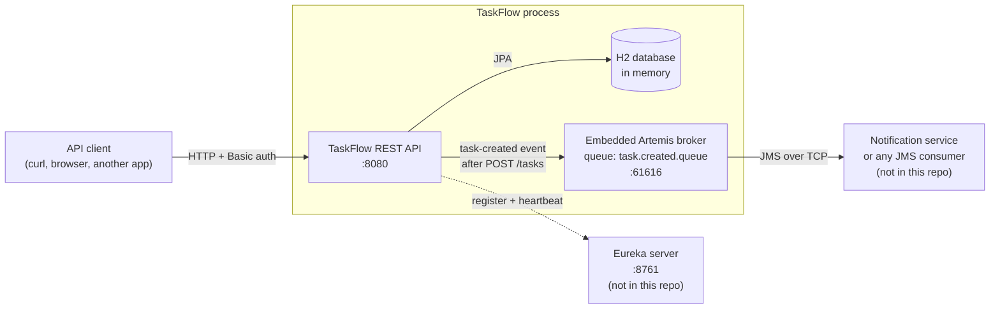

# TaskFlow

TaskFlow is a REST API for managing a to-do list, built with Spring Boot. You can create, list, filter, view, update and delete tasks. Each task has a title and a done/not-done status.

- Anyone can read tasks. Creating and updating tasks requires a login, and deleting requires an admin login.
- Each time a task is created, TaskFlow publishes a `task-created` event to a JMS message queue that other services can listen to.
- TaskFlow registers itself with a Eureka server so other services can discover it.

Tasks and users are stored in an in-memory H2 database, so **all data is lost when the application stops**.

## How TaskFlow talks to other services



- **H2** and the **Artemis broker** run inside the TaskFlow process, so nothing else needs to be installed for them.
- The broker also listens on TCP port **61616**, so other services can connect to it and read from `task.created.queue`.
- The **notification service** and the **Eureka server** are separate applications that aren't part of this repository. TaskFlow keeps working without them. See [Running without the other services](#running-without-the-other-services).

## Tech stack

- Java 25
- Spring Boot 4.1 (Web MVC, Data JPA, Validation, Security, Artemis/JMS)
- Spring Cloud 2025.1 (Netflix Eureka client)
- Apache Artemis 2.53, embedded message broker
- H2 in-memory database
- Maven (the wrapper is included, so you don't need to install Maven)

## Getting started

### Prerequisites

- JDK 25 or newer
- Ports **8080** (API) and **61616** (message broker) must be free.

### Run the application

```bash
# macOS / Linux / WSL
./mvnw spring-boot:run

# Windows
mvnw.cmd spring-boot:run
```

The API starts at `http://localhost:8080`.

### Run the tests

```bash
./mvnw test        # or mvnw.cmd test on Windows
```

| Test class                 | What it tests                                                                             |
|----------------------------|-------------------------------------------------------------------------------------------|
| `TaskControllerTest`       | Endpoints, validation, error bodies and security rules, with `TaskService` mocked          |
| `TaskRepositoryTest`       | Saving tasks and filtering by `done`, against a real in-memory database                    |
| `NotificationClientTest`   | Events go to the right queue, and a broker failure doesn't break task creation             |
| `TaskflowApplicationTests` | The whole application starts                                                               |

## Authentication

TaskFlow uses **HTTP Basic** authentication. Send a username and password with each request that needs one, for example `curl -u alice:alicepass`.

These accounts are created when the app starts:

| Username | Password    | Role    |
|----------|-------------|---------|
| `admin`  | `adminpass` | `ADMIN` |
| `alice`  | `alicepass` | `USER`  |

> These passwords are for local development only. They are set in `DataSeeder.java`.

| Request                                    | Who can do it            |
|--------------------------------------------|--------------------------|
| `GET /tasks`, `GET /tasks/{id}`            | Anyone, no login needed  |
| `POST /tasks`, `PUT /tasks/{id}`           | Any logged-in user       |
| `DELETE /tasks/{id}`                       | `ADMIN` only             |
| Everything else (including the H2 console) | Any logged-in user       |

No login or a wrong password returns `401 Unauthorized`. Being logged in without permission, for example `alice` deleting a task, returns `403 Forbidden`.

## API

All requests and responses use JSON.

### Task object

```json
{
  "id": 1,
  "title": "Buy groceries",
  "done": false
}
```

### Endpoints

| Method   | Path                | Login    | Description                | Success       | Errors              |
|----------|---------------------|----------|----------------------------|---------------|---------------------|
| `GET`    | `/tasks`            | —        | List all tasks             | `200` + array | —                   |
| `GET`    | `/tasks?done=true`  | —        | List only done tasks       | `200` + array | —                   |
| `GET`    | `/tasks?done=false` | —        | List only unfinished tasks | `200` + array | —                   |
| `POST`   | `/tasks`            | Any user | Create a task              | `200` + task  | `400`, `401`        |
| `GET`    | `/tasks/{id}`       | —        | Get one task               | `200` + task  | `404`               |
| `PUT`    | `/tasks/{id}`       | Any user | Update a task              | `200` + task  | `400`, `401`, `404` |
| `DELETE` | `/tasks/{id}`       | Admin    | Delete a task              | `204` no body | `401`, `403`, `404` |

### Request bodies

**Create** (`POST /tasks`). New tasks always start as not done.

```json
{ "title": "Buy groceries" }
```

**Update** (`PUT /tasks/{id}`). This replaces both fields, so send both. `done` is required. Leaving it out returns `400`.

```json
{ "title": "Buy groceries", "done": true }
```

In both requests, `title` is required and must not be blank.

### Error responses

A missing task (`404`) or a blank title (`400`) returns this format:

```json
{
  "timestamp": "2026-10-28T10:15:10.342Z",
  "status": 404,
  "message": "Task 99 not found"
}
```

For a blank title, `message` is `title must not be blank`. Other errors, such as invalid JSON or a missing `done` field, use Spring Boot's default error format. That format has `error` and `path` fields instead of `message`.

### Example with curl

```bash
# List tasks (no login needed)
curl http://localhost:8080/tasks

# List only unfinished tasks
curl "http://localhost:8080/tasks?done=false"

# Create a task
curl -u alice:alicepass -X POST http://localhost:8080/tasks \
  -H "Content-Type: application/json" \
  -d '{"title": "Buy groceries"}'

# Mark task 1 as done
curl -u alice:alicepass -X PUT http://localhost:8080/tasks/1 \
  -H "Content-Type: application/json" \
  -d '{"title": "Buy groceries", "done": true}'

# Delete task 1 (admin only)
curl -u admin:adminpass -X DELETE http://localhost:8080/tasks/1
```

On Windows PowerShell, use `curl.exe`, put each command on one line, and escape the inner quotes, for example `-d '{\"title\": \"Buy groceries\"}'`.

## Task-created events

After a task is saved, TaskFlow sends a message to the queue **`task.created.queue`** on the embedded Artemis broker. The message is a JMS text message:

- **Body** (JSON):
  ```json
  { "taskId": 1, "title": "Buy groceries" }
  ```
- **Property** `_type` = `task-created`, which tells consumers what kind of event it is.

To receive events, another service connects to the broker at `tcp://localhost:61616` and listens on `task.created.queue`.

If the event can't be sent, TaskFlow logs a warning (`Failed to publish task-created event ...`) and the request still succeeds. The task is saved either way.

## Service discovery (Eureka)

On startup, TaskFlow registers with a Eureka server at `http://localhost:8761/eureka/` under the name `TASKFLOW`, then sends a heartbeat every 30 seconds. Other services can then look up TaskFlow by name instead of hard-coding its address.

The Eureka server is a separate Spring Boot application with `spring-cloud-starter-netflix-eureka-server` and `@EnableEurekaServer`. It isn't included in this repository.

## Running without the other services

TaskFlow starts and serves requests even if nothing else is running:

| Missing service      | What happens                                                                                                  |
|----------------------|---------------------------------------------------------------------------------------------------------------|
| Eureka server        | `Connection refused ... localhost:8761` stack traces in the log every 30 seconds. The API works normally.      |
| Event consumer       | Events stay on `task.created.queue` until something reads them. They're lost when the app stops.              |

To hide the Eureka errors while you develop without a Eureka server, add this to `application.properties`:

```properties
eureka.client.enabled=false
```

## Configuration

Settings in `src/main/resources/application.properties`:

| Property                                  | Value                             | Purpose                                      |
|-------------------------------------------|-----------------------------------|----------------------------------------------|
| `spring.datasource.url`                   | `jdbc:h2:mem:taskflow`            | In-memory database                           |
| `spring.h2.console.enabled`               | `true`                            | H2 web console at `/h2-console`              |
| `spring.artemis.mode`                     | `embedded`                        | Run the message broker inside TaskFlow       |
| `spring.artemis.embedded.queues`          | `task.created.queue`              | Create the event queue at startup            |
| `eureka.client.service-url.defaultZone`   | `http://localhost:8761/eureka/`   | Where the Eureka server is                   |
| `eureka.instance.hostname`                | `localhost`                       | Address TaskFlow registers with              |

The broker's TCP port (61616) is set in `JmsConfig.java`.

## Known issues

- **The H2 console doesn't work in a browser.** `/h2-console` requires a TaskFlow login. Even after you log in, Spring Security's default `X-Frame-Options: DENY` header stops the console's page frames from loading. Using it would need a security rule that allows `/h2-console/**` and same-origin frames. The connection details are JDBC URL `jdbc:h2:mem:taskflow`, user `sa`, and an empty password.
- **Undelivered events are lost when the app stops.** The broker is embedded, so it stops with TaskFlow.

## Project structure

```
src/main/java/com/taskflow/
├── TaskflowApplication.java              # Application entry point
├── controller/TaskController.java        # REST endpoints
├── service/TaskService.java              # Business logic; publishes an event after create
├── client/
│   ├── NotificationClient.java           # Sends task-created events to the JMS queue
│   └── TaskCreatedEvent.java             # Event payload (taskId, title)
├── repository/
│   ├── TaskRepository.java               # Task storage, including findByDone
│   └── UserRepository.java               # User lookup by username
├── model/
│   ├── Task.java                         # Task entity
│   └── AppUser.java                      # User entity (username, password hash, role)
├── dto/
│   ├── CreateTaskRequest.java            # POST body (with validation)
│   ├── UpdateTaskRequest.java            # PUT body (with validation)
│   └── ErrorResponse.java                # JSON error body
├── exception/
│   ├── TaskNotFoundException.java        # Thrown when a task id doesn't exist
│   └── GlobalExceptionHandler.java       # Turns exceptions into 404/400 error bodies
└── config/
    ├── SecurityConfig.java               # Access rules, HTTP Basic, password hashing
    ├── TaskFlowUserDetailsService.java   # Loads users from the database for login
    ├── DataSeeder.java                   # Creates the admin and alice accounts at startup
    └── JmsConfig.java                    # JSON message format and broker TCP port
```

A request goes through Spring Security first, which checks the login and the access rules. It then goes from the controller to the service, and from the service to the repository, which reads and writes the database. After a task is created, the service calls `NotificationClient`, which publishes the event to the queue. Errors are turned into JSON responses by `GlobalExceptionHandler`. Passwords are stored as BCrypt hashes, never as plain text.
